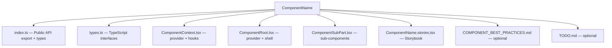

# UI Components — Best Practices & Architecture

## Philosophy

This UI library follows a **headless composition** pattern. Components provide **behavior and layout structure** but never dictate content. The consumer has full control over what renders inside each slot.

---

## Core Principles

### 1. Composition over Configuration

```tsx
// ❌ Data-driven (old pattern)
<Navbar items={[{ name: "Pricing", href: "/pricing" }]} />

// ✅ Composition-based (our pattern)
<Navbar.AppBar>
  <Navbar.Item><Anchor href="/pricing">Pricing</Anchor></Navbar.Item>
</Navbar.AppBar>
```

No data arrays. No mapping functions. No internal rendering logic. Everything is JSX children.

### 2. Single Wrapper, Single Purpose

Each component does ONE thing:
- **Layout containers** — control positioning, visibility, spacing
- **Content wrappers** — register children for cross-context rendering (e.g., mobile menu)
- **Behavior providers** — add interactivity (dropdown open/close, hover, etc.)

### 3. Opt-in Behavior

Features are off by default. Enable via boolean props:

```tsx
<Component isSticky={false} openOnHover={false} fullWidth={false} />
```

Never force behavior. Let the consumer decide.

### 4. Framework-Agnostic Content

Components never import or render specific content. The consumer provides:
- Their own Link component (Next.js Link, Astro `<a>`, etc.)
- Their own icons
- Their own buttons, inputs, custom components

### 5. Headless Where Possible

If a component's job is registration or behavior — render children as-is (fragment or minimal wrapper). Only add DOM wrappers when layout/spacing is needed.

---

## Component Design Patterns

### Compound Components

Group related components under a namespace object:

```tsx
export const ComponentName = {
  Root: ComponentRoot,
  SubPart: ComponentSubPart,
  Item: ComponentItem,
} as const;
```

### Registration Pattern

When children need to appear in another context (e.g., mobile menu):

```tsx
function ComponentItem({ children }) {
  const id = useId();
  const { register } = useContext();

  useEffect(() => {
    const unregister = register({ id, node: children });
    return unregister;
  }, [id, children, register]);

  return <>{children}</>;  // or minimal wrapper
}
```

Use `useSyncExternalStore` for reading registered items without causing re-renders on registration.

### Layout Slots

For components that need flexible positioning:

```tsx
function LayoutSlot({ children, flex, justify, hideOnMobile }) {
  return (
    <XStack
      flex={flex}
      justifyContent={justify}
      {...(hideOnMobile && { display: 'none', $md: { display: 'flex' } })}
    >
      {children}
    </XStack>
  );
}
```

### Context Provider at Root

Always provide context at the Root level. Never require consumers to wrap in a separate Provider:

```tsx
function ComponentRoot({ children, ...config }) {
  return (
    <ComponentProvider config={config}>
      {children}
    </ComponentProvider>
  );
}
```

---

## Styling Conventions

### Tamagui Tokens

Use standard Tamagui theme tokens only:

| Purpose | Token |
|---------|-------|
| Subtle background | `$color2`, `$color3` |
| Hover background | `$color3` |
| Press background | `$color4` |
| Border | `$borderColor` |
| Primary text | `$color11`, `$color12` |
| Secondary text | `$color9`, `$color10` |
| Focus ring | `$color8` |
| Page background | `$background` |

### Never use:
- `$accentColor`, `$accentColorHover` — don't exist
- `$backgroundHover`, `$backgroundPress` — don't exist
- Custom CSS variables
- Hardcoded colors

### Interactive States

```tsx
hoverStyle={{ backgroundColor: '$color3' }}
pressStyle={{ backgroundColor: '$color4' }}
focusVisibleStyle={{
  outlineWidth: 2,
  outlineColor: '$color8',
  outlineStyle: 'solid',
  outlineOffset: 2,
}}
```

### Primary CTA Buttons

Use `theme="active"` on Tamagui `<Button>`:

```tsx
<Button theme="active">Get Started</Button>
```

### Link Styling

Use Tamagui `<Anchor>` for links — it handles color and text-decoration automatically.

---

## File Structure



### index.ts Pattern

```tsx
export type { ... } from './types';
export { useComponentName } from './ComponentContext';

import { ComponentRoot } from './ComponentRoot';
import { ComponentItem } from './ComponentItem';
// ...

export const ComponentName = {
  Root: ComponentRoot,
  Item: ComponentItem,
  // ...
} as const;
```

---

## Storybook Conventions

### Meta

```tsx
const meta: Meta = {
  title: 'Components/ComponentName',
  parameters: {
    layout: 'fullscreen',  // or 'centered', 'padded'
    docs: {
      description: {
        component: `Description with ## headings, key components list, and usage example.`,
      },
    },
  },
  argTypes: {
    propName: { control: 'boolean', description: '...' },
  },
  args: {
    propName: false,  // defaults
  },
};
```

### Stories

- **Default** — Full-featured example with all controls wired up
- **Minimal** — Simplest possible usage
- **WithCustomComponents** — Shows extensibility with custom content
- **Variant stories** — One per major configuration (e.g., WithoutGlobalBar)

### Controls

Expose key behavioral props as Storybook controls:
- Boolean toggles for opt-in features
- Select/radio for enum props
- No controls for content — that's shown via different stories

---

## Accessibility Checklist

- [ ] Semantic HTML tags (`<nav>`, `<header>`, `<button>`, etc.)
- [ ] `aria-label` on navigation landmarks
- [ ] `aria-expanded` on expandable triggers
- [ ] `aria-haspopup` on dropdown triggers
- [ ] `aria-current="page"` for active navigation items
- [ ] Visible focus indicators (`focusVisibleStyle`)
- [ ] Keyboard navigation (Tab, Escape, Arrow keys where appropriate)
- [ ] Screen reader announcements for state changes
- [ ] `prefers-reduced-motion` respect for animations
- [ ] Minimum 44px touch targets on mobile

---

## Performance Guidelines

- Use `useCallback` for registration functions passed to children
- Store registered items in `useRef` (not state) to avoid cascading re-renders
- Use `useSyncExternalStore` for reading registered items reactively
- Avoid inline object/array creation in render (memoize with `useMemo`)
- Lazy-render mobile overlays (only mount when open)
- Use Tamagui's `animation` prop instead of CSS transitions where possible

---

## Adding a New Component

1. Create folder: `src/components/ComponentName/`
2. Define types in `types.ts`
3. Create context in `ComponentContext.tsx`
4. Build compound components (Root, sub-parts)
5. Export from `index.ts` as namespace object
6. Add to `src/index.ts` (main library export)
7. Write stories with controls and docs description
8. Verify with `npx tsc --noEmit`
9. Test in Storybook across viewports
