# Navbar — Best Practices & Architecture

## Philosophy

Headless composition-based navbar. Every piece is a slot that accepts any children.
No data arrays, no mapping — pure JSX composition.

---

## File Structure

```mermaid
flowchart TD
  root[Navbar]
  root --> indexTs["index.ts — public API"]
  root --> typesTs["types.ts — RegisteredNavItem / Dropdown"]
  root --> ctx["NavbarContext.tsx — Provider + useNavbar"]
  root --> rootCmp["NavbarRoot.tsx — root + mobile overlay host"]
  root --> globalBar["NavbarGlobalBar.tsx — optional utility bar"]
  root --> appBar["NavbarAppBar.tsx — main bar sticky option"]
  root --> appBarItem["NavbarAppBarItem.tsx — layout slot"]
  root --> item["NavbarItem.tsx — content + mobile registration"]
  root --> dropdown["NavbarDropdown.tsx — dropdown + openOnHover"]
  root --> trigger["NavbarDropdownTrigger.tsx — chevron trigger"]
  root --> content["NavbarDropdownContent.tsx — floating panel"]
  root --> dropItem["NavbarDropdownItem.tsx — accordion registration"]
  root --> toggle["NavbarMobileToggle.tsx — hamburger"]
  root --> overlay["NavbarMobileOverlay.tsx — mobile sheet"]
  root --> stories["Navbar.stories.tsx — Storybook"]
  root --> practices["NAVBAR_BEST_PRACTICES.md — this file"]
```



---

## Component API

| Component | Purpose | Key Props |
|-----------|---------|-----------|
| `Navbar.Root` | Context provider | `linkComponent?` |
| `Navbar.GlobalBar` | Top utility bar | — |
| `Navbar.AppBar` | Main nav bar | `isSticky?` |
| `Navbar.AppBarItem` | Layout slot | `flex?`, `justify?`, `hideOnMobile?` |
| `Navbar.Item` | Content wrapper | — |
| `Navbar.Dropdown` | Dropdown container | `openOnHover?` |
| `Navbar.DropdownTrigger` | Trigger + chevron | — |
| `Navbar.DropdownContent` | Floating grid panel | `columns?`, `fullWidth?` |
| `Navbar.DropdownItem` | Item + mobile reg | — |

---

## Typography

`Navbar.Item`, `Navbar.DropdownTrigger`, and `Navbar.AppBarItem` default label tokens to `$body` / `$4` / `400` (via `navTypography`). Any child (`Anchor`, `Text`, `Button`, …) inherits those unless it sets `fontFamily` / `fontSize` / `fontWeight` explicitly.

---

## Responsive Columns

`DropdownContent` uses a desktop-first approach with `$maxXxx` breakpoints:

```tsx
// Default: 3 cols on XL+, 2 on LG, 1 on mobile
<Navbar.DropdownContent columns={{ xs: 1, lg: 2, xl: 3 }} />
```

**Why desktop-first?** Tamagui's `min-width` breakpoints have inverted CSS specificity
(smaller breakpoints override larger ones). Using `max-width` breakpoints avoids this issue.

The `buildResponsiveColumns` utility in `src/utils/` handles the conversion and is
reusable across any component that needs responsive grid layouts.

---

## Mobile Menu

Items wrapped in `Navbar.Item` and `Navbar.DropdownItem` are automatically registered
in context and rendered in the mobile bottom sheet. No manual duplication needed.

Dropdowns become accordions in the mobile menu.

---

## Key Design Decisions

1. **One component per file** — easier to navigate, extend, and tree-shake
2. **No `styled()` variants yet** — planned for spacing/density customization
3. **`columns` accepts only `ResponsiveColumns` object** — no plain number, forces explicit responsive intent
4. **Desktop-first responsive** — base = largest screen, `$maxXxx` for smaller
5. **`buildResponsiveColumns` utility** — extracted for reuse in future grid components

---

## Usage Example

```tsx
<Navbar.Root>
  <Navbar.GlobalBar>
    <Navbar.Item><Anchor href="/shop">Shop</Anchor></Navbar.Item>
  </Navbar.GlobalBar>

  <Navbar.AppBar isSticky>
    <Navbar.AppBarItem>
      <Logo />
    </Navbar.AppBarItem>

    <Navbar.AppBarItem flex={1} justify="center" hideOnMobile>
      <Navbar.Item><Anchor href="/pricing">Pricing</Anchor></Navbar.Item>
      <Navbar.Dropdown openOnHover>
        <Navbar.DropdownTrigger><Button chromeless>Products</Button></Navbar.DropdownTrigger>
        <Navbar.DropdownContent columns={{ xs: 1, lg: 2, xl: 3 }}>
          <Navbar.DropdownItem>
            <ListItem icon={BarChart3} title="Analytics" />
          </Navbar.DropdownItem>
        </Navbar.DropdownContent>
      </Navbar.Dropdown>
    </Navbar.AppBarItem>

    <Navbar.AppBarItem hideOnMobile>
      <Navbar.Item><Button theme="active">Get Started</Button></Navbar.Item>
    </Navbar.AppBarItem>
  </Navbar.AppBar>
</Navbar.Root>
```
